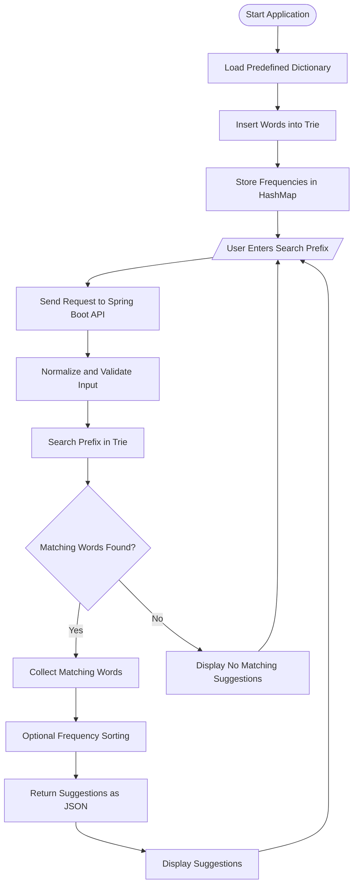

# 🔍 Auto-Complete Search Engine

## 📌 About the Project

**Auto-Complete Search Engine** is a web-based application that provides real-time word suggestions as users type into a search box. It is developed as a Data Structures and Algorithms (DSA) project using Java, Spring Boot, Trie Data Structure, and HashMap.

The primary purpose of this project is to demonstrate how efficient data structures can be used to build a practical search suggestion system.

Unlike a traditional searching approach that scans an entire list of words, this application uses a **Trie (Prefix Tree)** to efficiently locate words matching the entered prefix. A HashMap maintains the frequency of each word, which can optionally be used to rank suggestions based on their frequency.

The frontend is developed using HTML, CSS, and JavaScript, while the backend uses Java and Spring Boot. Both communicate through a REST API that returns matching suggestions in JSON format.

For example, when a user types `pro`, the application can suggest:

- programming
- program
- project
- programmer

The application also handles invalid, empty, and unmatched search inputs.

## ✨ Key Features

- **Real-Time Suggestions:** Displays matching words dynamically while the user types.
- **Efficient Prefix Searching:** Uses Trie Data Structure instead of scanning the complete dictionary.
- **Frequency-Based Ranking:** Uses HashMap to store word frequencies and optionally prioritize frequently used words.
- **Interactive User Interface:** Provides a simple and user-friendly search experience.
- **REST API Integration:** Connects the frontend with the Java backend through Spring Boot.
- **Input Normalization:** Automatically trims extra spaces and converts uppercase characters into lowercase.
- **Suggestion Selection:** Allows users to click a suggestion to fill the search box.
- **No-Match Handling:** Displays an appropriate message when no matching words are found.
- **Lightweight Application:** Uses a predefined dictionary without requiring a database.

## 🛠️ Technologies Used

| Technology    | Purpose                                 |
| ------------- | --------------------------------------- |
| Java (JDK 21) | Core programming language               |
| Spring Boot   | Backend development and REST API        |
| Trie          | Efficient prefix-based searching        |
| HashMap       | Word frequency storage                  |
| HTML5         | Frontend structure                      |
| CSS3          | Frontend styling                        |
| JavaScript    | Dynamic search functionality            |
| Maven         | Project build and dependency management |
| JSON          | Frontend-backend communication          |

## 🧠 Data Structures and Algorithms

This project focuses on the practical implementation of two important data structures.

### 1. Trie (Prefix Tree)

A Trie is a tree-based data structure used to store and search strings efficiently.

In this project, every dictionary word is inserted into the Trie character by character.

**How it works:**

1. Each Trie node represents a character.
2. Every node contains up to 26 child references for English lowercase letters (a–z).
3. The `isEndOfWord` flag identifies whether a complete word ends at a particular node.
4. When a user enters a prefix, the Trie follows the corresponding character paths.
5. All complete words below the matching prefix node are collected as suggestions.

**Main Operations:**

- `insert(word)` – Inserts a word into the Trie.
- `searchPrefix(prefix)` – Finds all words matching the given prefix.
- `collectWords(node)` – Collects complete words from the matching Trie node.

### 2. HashMap

A HashMap stores each dictionary word along with its frequency count.

**Example:**

| Word        | Frequency |
| ----------- | --------: |
| programming |        95 |
| program     |        90 |
| data        |        92 |
| project     |        80 |
| programmer  |        60 |
| search      |        85 |

The HashMap allows the application to retrieve frequency values efficiently and optionally sort matching suggestions from highest to lowest frequency.

### 3. Java String Processing

Java String operations are used to normalize and validate the search input.

- `trim()` – Removes unnecessary spaces.
- `toLowerCase()` – Converts text into lowercase.
- Input validation – Handles empty and invalid inputs.

## ⚙️ How the Application Works

The application follows a simple sequence of operations:

1. **Load Dictionary:** A predefined dictionary containing words and their frequency values is loaded when the application starts.
2. **Insert Words:** Each dictionary word is inserted into the Trie.
3. **Store Frequencies:** Word frequency values are stored in a HashMap.
4. **Receive Input:** The user enters a search prefix in the frontend search box.
5. **Send API Request:** JavaScript sends the entered prefix to the Spring Boot backend.
6. **Normalize Input:** The backend trims spaces, converts text to lowercase, and validates the input.
7. **Search Trie:** The Trie searches for the entered prefix.
8. **Collect Suggestions:** All matching words are collected from the corresponding Trie node.
9. **Sort Suggestions:** Matching words can optionally be sorted according to their frequency.
10. **Display Results:** The backend returns a JSON response, and JavaScript displays the suggestions dynamically.

## 🔄 Application Workflow



## 🏗️ Project Architecture

The application is divided into backend and frontend components.

### Backend Components

| Class              | Responsibility                                                                    |
| ------------------ | --------------------------------------------------------------------------------- |
| `TrieNode`         | Represents an individual Trie node with child references and an end-of-word flag. |
| `Trie`             | Handles word insertion, prefix searching, and collecting matching words.          |
| `SearchService`    | Manages the Trie, HashMap, dictionary loading, and suggestion generation.         |
| `SearchController` | Handles REST API requests and returns search suggestions as JSON.                 |

### Frontend Components

| File         | Responsibility                                                                 |
| ------------ | ------------------------------------------------------------------------------ |
| `index.html` | Provides the search box and suggestion display area.                           |
| `style.css`  | Defines the visual appearance of the application.                              |
| `script.js`  | Sends search requests, displays suggestions, and handles suggestion selection. |

## 🔌 API Documentation

The application uses a Spring Boot REST API to retrieve word suggestions.

### Get Search Suggestions

**Endpoint:**

```http
GET /api/suggestions?prefix=pro
```

**Request Parameter:**

| Parameter | Type   | Description                          |
| --------- | ------ | ------------------------------------ |
| prefix    | String | The word prefix entered by the user. |

**Example Request:**

```http
GET /api/suggestions?prefix=pro
```

**Example JSON Response:**

```json
[
  "programming",
  "program",
  "project",
  "programmer"
]
```

The suggestions can be ordered according to their stored frequency values.

### No Matching Results

**Example Request:**

```http
GET /api/suggestions?prefix=xyz
```

**Expected Response:**

```json
[]
```

The frontend displays:

```text
No matching suggestions found.
```

## ⏱️ Time Complexity Analysis

Let:

- `L` = Length of the word.
- `P` = Length of the search prefix.
- `K` = Number of matching words.

| Operation               | Time Complexity                                 |
| ----------------------- | ----------------------------------------------- |
| Trie Insertion          | O(L)                                            |
| Trie Prefix Search      | O(P)                                            |
| Collect Matching Words  | Depends on the number of nodes below the prefix |
| HashMap Lookup          | O(1) Average                                    |
| Frequency-Based Sorting | O(K log K)                                      |

**Why Trie?**

A traditional linear searching approach checks every word in the dictionary. A Trie follows only the character path corresponding to the entered prefix, making it suitable for prefix-based searching.

## 📂 Project Structure

The following is a suggested logical organization of the project:

```text
Auto-Complete-Search-Engine/
│
├── src/
│   └── main/
│       ├── java/
│       │   └── .../
│       │       ├── TrieNode.java
│       │       ├── Trie.java
│       │       ├── SearchService.java
│       │       └── SearchController.java
│       │
│       └── resources/
│           ├── static/
│           │   ├── index.html
│           │   ├── style.css
│           │   └── script.js
│           │
│           └── application.properties
│
├── pom.xml
└── README.md
```

*Note: This is a suggested structure. Adjust it according to your actual repository organization and Java package names.*

## 🚀 Installation and Setup

Follow these steps to run the project locally.

### Prerequisites

Make sure you have installed:

- Java Development Kit (JDK 21)
- Apache Maven
- IntelliJ IDEA or Visual Studio Code
- A modern web browser

### Step 1: Clone the Repository

```bash
git clone YOUR_GITHUB_REPOSITORY_URL
```

### Step 2: Navigate to the Project Directory

```bash
cd Auto-Complete-Search-Engine
```

### Step 3: Build the Project

```bash
mvn clean install
```

### Step 4: Run the Spring Boot Application

```bash
mvn spring-boot:run
```

Alternatively, you can run the main Spring Boot application class directly from your IDE.

### Step 5: Open the Application

If the frontend files are configured in Spring Boot's static resources directory, open:

```text
http://localhost:8080
```

Otherwise, open the frontend separately and configure its API request to point to the running Spring Boot backend.

## 🖥️ Sample Input and Output

### Example 1: Matching Suggestions

**Input:**

```text
pro
```

**Output:**

```text
programming
program
project
programmer
```

### Example 2: Input Normalization

**Input:**

```text
 PRO
```

**Normalized Input:**

```text
pro
```

**Output:**

```text
programming
program
project
programmer
```

### Example 3: No Matching Suggestions

**Input:**

```text
xyz
```

**Output:**

```text
No matching suggestions found.
```

## 🎯 Project Objectives

The main objectives of this project are:

- To develop a web-based auto-complete search application.
- To understand and implement Trie Data Structure.
- To use HashMap for storing word frequency values.
- To implement efficient prefix-based searching.
- To understand Java String operations and input validation.
- To integrate a Java backend with a frontend using REST APIs.
- To understand the time complexity of different DSA operations.

## 🔮 Future Enhancements

The following features can be considered for future development:

- Expand the predefined dictionary with more words.
- Implement functionality to add and remove dictionary words.
- Integrate a database for persistent word storage.
- Develop a visual representation of Trie operations.
- Improve the suggestion system with additional search capabilities.

*These enhancements are planned possibilities and are not part of the current project scope.*

## 🎓 Academic Information

| Detail            | Information                                       |
| ----------------- | ------------------------------------------------- |
| Project Title     | Auto-Complete Search Engine                       |
| Subject           | Data Structures and Algorithms (DSA)              |
| Course            | B.Tech – Computer Science & Engineering (AI & ML) |
| University        | Rungta International Skills University            |
| Academic Session  | 2026–27                                           |
| Project Guide     | Mr. Santanu Sasmal                                |
| Project Developer | Divyanshu Kumar                                   |

## 👨‍💻 Author

**Divyanshu Kumar**

B.Tech – Computer Science & Engineering (Artificial Intelligence and Machine Learning)

Rungta International Skills University, Bhilai, Chhattisgarh.

## 📚 References

1. Thomas H. Cormen, Charles E. Leiserson, Ronald L. Rivest, and Clifford Stein – *Introduction to Algorithms*, 4th Edition.
2. Robert Sedgewick and Kevin Wayne – *Algorithms*, 4th Edition.
3. [Oracle Java Documentation](https://docs.oracle.com/en/java/)
4. [Spring Boot Reference Documentation](https://docs.spring.io/spring-boot/)

---


Built with Java, DSA, and a passion for problem-solving. 🚀
⭐ If you find this project useful, consider giving the repository a star!
